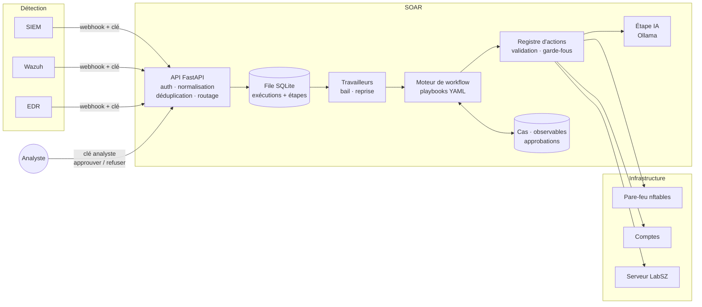

# Plateforme SOAR : automatisation de la réponse aux incidents de sécurité

**Une plateforme SOAR (Security Orchestration, Automation and Response) minimale, écrite en Python, qui reçoit des alertes de sécurité, exécute des playbooks YAML de réponse aux incidents, regroupe les alertes en cas et garde un humain dans la boucle pour les actions à risque.**


> 🇬🇧 *English summary at the [end of this page](#english-summary).*

L'architecture reprend, en petit, celle de **[Tracecat](https://github.com/TracecatHQ/tracecat)**, un SOAR open source : registre d'intégrations, moteur de workflow, API à webhooks, exécution durable, gestion de cas et étapes d'IA. Le tout est évalué sur un **scénario d'attaque réaliste** rejoué de bout en bout et noté automatiquement sur 100.

---

## Travail réalisé

- **Actions de réponse** : mise en œuvre du registre d'actions (blocage d'IP, désactivation de comptes, arrêt de processus, lecture et retrait de clés SSH) avec validation des entrées, garde-fous et idempotence.
- **Playbooks** : rédaction et exécution de playbooks YAML pour la force brute SSH, les connexions suspectes et l'activité anormale sur le serveur.
- **Réception des alertes** : API FastAPI qui reçoit les alertes SIEM, Wazuh et EDR, les normalise vers un format commun et les dédoublonne.
- **Exécution durable** : file SQLite et travailleurs parallèles, reprise après panne sans double action, annulation d'exécutions.
- **Gestion des cas** : corrélation des alertes par observables, approbation humaine des actions sensibles, rapport d'incident et calcul du MTTD et du MTTC.
- **IA** : intégration d'un LLM local pour repérer la clé SSH et la crontab de l'attaquant, avec défense contre l'injection de prompt.
- **Validation** : rejeu d'un scénario d'intrusion sur de vrais journaux SSH (95/100 avec l'étape IA, 83/100 sans, 11 verdicts justes sur 11), 45 tests automatisés et intégration continue GitHub Actions (Linux et Windows).

## Ce que fait le SOAR

| Composant | Module | Points clés |
|---|---|---|
| **Registre d'actions** | `minisoar/actions.py` | 12 intégrations (journaux, RDAP, pare-feu nftables, comptes, processus, ntfy…), entrées validées par **pydantic**, garde-fous dans l'action, idempotence, secrets hors des playbooks, réessais avec attente exponentielle |
| **Moteur de workflow** | `minisoar/moteur.py` | playbooks **YAML** au format Tracecat, `depends_on` + tri topologique (Kahn, détection de cycles), `run_if`, expressions `${{ }}` évaluées **sans `eval()`** (liste blanche sur l'AST), historique de chaque étape |
| **API** | `minisoar/api.py` | **FastAPI**, webhooks authentifiés par clé, normalisation **SIEM / Wazuh / EDR** vers un format commun (inspiré d'ECS/OCSF), déduplication par empreinte, routage règle → playbook |
| **Exécution durable** | `minisoar/file.py` | file **SQLite** (WAL), travailleurs parallèles, réservation atomique (`UPDATE … RETURNING`), **bail** renouvelé, reprise après panne sans refaire les étapes enregistrées (garantie « au moins une fois »), annulation |
| **Cas et approbations** | `minisoar/cas.py` | regroupement des alertes en **cas** par observables (IP, comptes, fichiers, URL), **fusion** de cas, approbation humaine des actions sensibles, rapport d'incident Markdown, **MTTD / MTTC** |
| **Étape IA** | `minisoar/ia.py` | `ai.action` (une réponse JSON contrainte par schéma) et `ai.agent` (boucle bornée sur une **liste blanche** d'actions), modèle local via **Ollama** + LangChain, défense contre l'**injection de prompt** |

## Architecture



Un playbook est une **donnée**, pas du code. Extrait de `playbooks/connexion-suspecte-cas.yaml` :

```yaml
- ref: bloquer
  action: pare_feu.bloquer_ip
  depends_on: [bilan, enrichir]
  run_if: ${{ not ACTIONS.enrichir.result.interne }}
  args:
    ip: ${{ TRIGGER.ip }}

- ref: desactiver
  action: comptes.desactiver
  depends_on: [bilan, enrichir]
  run_if: ${{ not ACTIONS.enrichir.result.interne && FN.length(ACTIONS.bilan.result.comptes_entres) > 0 }}
  args:
    compte: ${{ ACTIONS.bilan.result.comptes_entres[0] }}
  approbation: true          # un analyste doit accepter
```

| Playbook | Déclencheur | Réponse |
|---|---|---|
| `force-brute` | R1 : 5 échecs SSH en 2 min | bilan SSH, blocage si aucune connexion réussie, cas fermé automatiquement |
| `connexion-suspecte(-cas)` | R2 : succès après échecs · R3 : compte leurre | bilan, enrichissement RDAP, blocage (jamais une IP interne), désactivation du compte avec approbation |
| `activite-hote(-cas)` | R4 : connexion sortante suspecte · R5 : CPU saturé | arrêt du processus malveillant, lecture de l'historique et de la crontab, désactivation avec approbation |
| `activite-hote-ia` | R4, R5 | + analyse IA des clés SSH et de la crontab, retrait de la ligne malveillante avec approbation |

## Le scénario d'évaluation

Le banc d'essai (`banc/`) rejoue la matinée du **10 décembre 2016** sur le serveur LabSZ : 2 000 lignes **réelles** de journal SSH ([Loghub](https://github.com/logpai/loghub)), auxquelles s'ajoute une attaque synthétique :

- un attaquant **lent** (jamais 5 échecs en 2 minutes, il passe sous la règle de force brute) qui finit par entrer sur `webadmin` ;
- reconnaissance, téléchargement d'un script, **clé SSH** et **crontab** de persistance, **mineur de cryptomonnaie** ;
- du bruit légitime (l'administratrice qui se trompe de mot de passe, une clé de déploiement, une sauvegarde) ;
- une **injection de prompt** cachée dans un nom d'utilisateur SSH, qui demande de bloquer le poste de l'administratrice.

Les 11 alertes partent par HTTP vers le webhook de leur outil, dans leur format. Le correcteur note le SOAR sur 100 : justesse des verdicts (35), faits retrouvés dans les rapports (35), actions de confinement vérifiées dans l'environnement (30), et **pénalités** pour les dégâts (poste légitime bloqué, clé légitime retirée, IP inventée…).

| Configuration | Verdicts | Faits | Réponse | **Score** |
|---|---|---|---|---|
| `--mode simple` : API + playbooks déterministes | 32/35 | 30/35 | 18/30 | **80/100** |
| `--mode complet` : + file durable, cas, approbations | 35/35 | 30/35 | 18/30 | **83/100** |
| `--mode ia` : + étape IA (Ollama, `qwen2.5:3b`) | 35/35 | 30/35 | 30/30 | **95/100** |

Le mode complet relie 4 alertes en un seul cas critique (dont une fusion à 09:20), ferme automatiquement les 6 cas de robots et mesure **MTTD = 1 h 15 min 55 s** (début de l'attaque → détection) et **MTTC = 0 s** (détection → premier confinement). Les deux actions restantes (retirer la clé SSH et la crontab de l'attaquant) demandent du **jugement** : c'est le rôle de l'étape IA, toujours sous approbation humaine. Avec `qwen2.5:3b` exécuté en local sur CPU (portable i7, 16 Go de RAM), le modèle désigne la bonne clé et la bonne ligne de crontab parmi les entrées légitimes, sans aucun dégât : **95/100** pour un rejeu complet de 55 s. Le seul fait manqué est le signalement de l'IP source de l'injection de prompt (198.51.100.23), que le modèle n'a pas relevée, mais à laquelle il n'a pas obéi non plus.

## Sécurité dès la conception

- **Les entrées viennent de l'attaquant** : chaque argument d'action est typé et validé (pydantic) avant toute exécution ; une alerte malformée est refusée (HTTP 422).
- **Garde-fous dans l'action**, pas dans le playbook ni dans un prompt : impossible de bloquer une IP interne, de désactiver `root`, de tuer un processus système ou de lire `/etc/shadow`.
- **Pas d'`eval()`** : les expressions des playbooks sont analysées en AST avec une liste blanche (pas d'attributs `_`, pas d'appels hors `FN.*`), ce qui bloque l'injection de gabarit.
- **Secrets** dans l'environnement (`SOAR_SECRET_*`), jamais dans les playbooks.
- **Séparation des rôles** : la clé du SIEM permet de *signaler*, seule la clé des analystes permet de *décider* (approuver, refuser, annuler).
- **Idempotence** de toutes les actions, condition d'une reprise après panne sans double effet.
- **IA encadrée** : sortie contrainte par schéma, agent en lecture seule sur liste blanche et nombre d'appels borné, approbation de la ligne exacte avant tout retrait.

## Démarrage rapide

Python 3.10 ou plus.

```bash
git clone https://github.com/Chris-Lorys/soar-incident-response.git
cd soar-incident-response
python -m venv .venv
source .venv/bin/activate          # Windows : .venv\Scripts\activate
pip install -r requirements-dev.txt

python rejouer.py                  # rejoue la matinée et affiche le score
pytest                             # 45 tests
```

Après un rejeu, ouvrez `environnement/` (pare-feu nftables, comptes, disque du serveur, `audit.jsonl`, base SQLite) pour voir ce que le SOAR a fait, et `resultats/` pour le rapport d'incident.

### Lancer l'API et un travailleur

Sans `SOAR_MODE`, l'API exécute le playbook pendant la requête (mode synchrone). Avec `SOAR_MODE=durable`, elle dépose l'exécution dans la file, répond tout de suite, et des travailleurs l'exécutent, avec cas et approbations.

```bash
export SOAR_SECRET_WEBHOOK=cle-siem SOAR_SECRET_ANALYSTES=cle-analystes SOAR_MODE=durable
uvicorn minisoar.api:app --port 8000        # documentation interactive : http://localhost:8000/docs
python -m minisoar.travailleur              # dans un autre terminal (mêmes variables)
```

```bash
curl -X POST localhost:8000/webhooks/siem -H "x-soar-cle: cle-siem" -H "Content-Type: application/json" \
     -d '{"id":"A06","horodatage":"2016-12-10T08:41:12","regle":"R2-succes-apres-echecs","niveau":7,
          "hote":"LabSZ","ip":"203.0.113.77","compte":"webadmin",
          "description":"Connexion SSH réussie pour webadmin après 9 échecs depuis 203.0.113.77"}'
```

| Méthode | Route | Rôle |
|---|---|---|
| `POST` | `/webhooks/{siem\|wazuh\|edr}` | recevoir une alerte (clé SIEM) |
| `GET` | `/executions/{id}` | historique d'une exécution |
| `POST` | `/executions/{id}/annuler` | annuler une exécution en file (clé analystes) |
| `GET` | `/cas`, `/cas/{id}` | liste des cas, rapport et mesures (clé analystes) |
| `GET` | `/approbations` | actions en attente d'un humain (clé analystes) |
| `POST` | `/approbations/{execution}/{ref}` | approuver ou refuser (clé analystes) |

### Étape IA (facultatif)

```bash
ollama pull qwen2.5:3b              # ou SOAR_MODELE=qwen2.5:7b
python rejouer.py --mode ia
```

### Carnets Jupyter

`notebooks/` contient six carnets exécutables qui présentent chaque composant pas à pas (registre, moteur, API, exécution durable, cas, IA), avec leurs sorties.

## Tests

```
tests/
├── test_actions.py        validation, garde-fous, idempotence, secrets, réessais
├── test_moteur.py         expressions, injection de gabarit, validation des playbooks, exécutions
├── test_api.py            authentification, normalisation SIEM/Wazuh/EDR, déduplication, routage
├── test_file_durable.py   panne d'un travailleur réel (sous-processus) puis reprise, annulation
├── test_cas.py            approbation / refus humain, rejeu complet, fusion de cas
└── test_ia.py             sortie par schéma et liste blanche de l'agent (faux modèle, sans Ollama)
```

## Structure

```
soar-incident-response/
├── minisoar/        le SOAR (actions, moteur, api, file, cas, ia, travailleur)
├── playbooks/       playbooks YAML
├── banc/            banc d'essai : scénario, environnement simulé, rejeu et notation
├── donnees/         journal SSH réel (Loghub)
├── notebooks/       carnets de démonstration
├── tests/           tests pytest
└── rejouer.py       rejeu de bout en bout en ligne de commande
```

## Limites et pistes

- L'infrastructure est **simulée** (fichiers) : les intégrations réelles (nftables, Active Directory, EDR) seraient des actions de plus dans le registre.
- Une exécution déjà en cours ne peut pas être annulée : il faudrait que le moteur vérifie un signal entre deux étapes (comme les signaux d'annulation de Temporal).
- Les observables trop communs (`root`) peuvent relier des alertes sans rapport : une liste d'exclusion améliorerait le rattachement.
- Pistes : interface web pour les analystes, métriques Prometheus, intégration MITRE ATT&CK des cas.

## Crédits

- Architecture inspirée de [Tracecat](https://github.com/TracecatHQ/tracecat).
- Journal SSH : [Loghub](https://github.com/logpai/loghub), jeu `OpenSSH_2k`.

---

## English summary

This project is a small Security Orchestration, Automation and Response platform written in Python, modelled on the open-source SOAR Tracecat. It receives alerts from a SIEM, Wazuh or an EDR through authenticated FastAPI webhooks, normalises and deduplicates them, and runs YAML playbooks through a workflow engine (topological ordering, conditional steps, sandboxed `${{ }}` expressions evaluated on a whitelisted AST instead of `eval`). Actions go through a typed registry with input validation, built-in guardrails, idempotency and retries. Executions are durable (SQLite queue, parallel workers, leases, crash recovery), alerts are grouped into cases by shared observables, risky actions wait for analyst approval, and optional AI steps (local LLM via Ollama) are constrained by JSON schemas, tool whitelists and human review to resist prompt injection.

It is evaluated by replaying a realistic attack (real OpenSSH logs from Loghub plus a synthetic slow brute-force intrusion, persistence and cryptominer) and scored out of 100: the deterministic configuration reaches **83/100** with all 11 verdicts correct, and **95/100** with the AI step (local `qwen2.5:3b` on CPU), which picks the attacker's SSH key and cron entry among legitimate ones with no collateral damage. It ships with 45 pytest tests and continuous integration.
